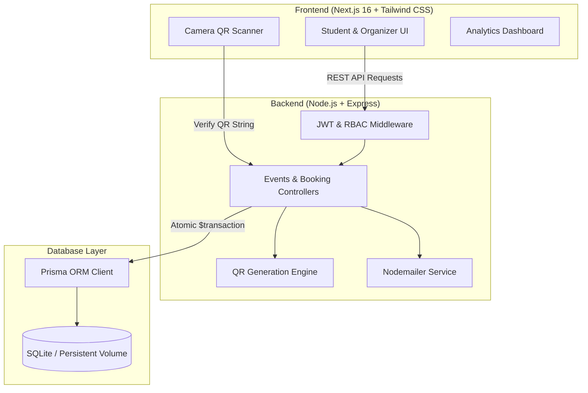

# 🎓 EventHive — Campus Event & Booking System

[](https://nextjs.org/)
[](https://expressjs.com/)
[](https://www.prisma.io/)
[](https://www.sqlite.org/)
[](https://tailwindcss.com/)
[](https://vercel.com/)
[](https://render.com/)

An end-to-end event discovery, ticket reservation, and administrative verification platform engineered for university campuses. Designed to eliminate overbooking through atomic transactions, streamline event admissions with in-browser QR camera verification, and provide event organizers with real-time analytics.

---

## 📑 Table of Contents

- [Key Features](#-key-features)
- [System Architecture](#-system-architecture)
- [Tech Stack](#-tech-stack)
- [Directory Layout](#-directory-layout)
- [Getting Started Locally](#-getting-started-locally)
  - [Prerequisites](#prerequisites)
  - [1. Clone & Dependencies](#1-clone--dependencies)
  - [2. Environment Variables](#2-environment-variables)
  - [3. Database Setup & Seeding](#3-database-setup--seeding)
  - [4. Running Development Servers](#4-running-development-servers)
  - [Demo Accounts](#demo-accounts)
- [API Reference](#-api-reference)
- [Production Deployment](#-production-deployment)
  - [Deploy Backend (Render / Railway)](#deploy-backend-render--railway)
  - [Deploy Frontend (Vercel)](#deploy-frontend-vercel)
  - [Environment Variables Checklist](#environment-variables-checklist)
- [Security & Concurrency Handling](#-security--concurrency-handling)
- [License](#-license)

---

## ✨ Key Features

### 👨‍🎓 For Students
* **Event Discovery & Filtering:** Browse campus events by category (Technology, Cultural, Sports, Academic, Social), search by title/venue, and view real-time available seat counters.
* **Instant Ticket Reservation:** 1-click booking with atomic seat reservation (guarantees zero overbooking).
* **Digital QR Pass:** Automatically generates unique high-density QR tickets viewable directly in the Student Dashboard and emailed upon reservation.
* **Booking Management:** Review active passes and cancel bookings anytime (releasing seats back to the community immediately).

### 🎪 For Organizers
* **Event Management:** Create, publish, modify, and cancel campus events with venue configurations, date-time pickers, and seat capacity limits.
* **Live Occupancy & Sales Analytics:** Visual analytics powered by Recharts (attendance status breakdown, ticket distribution donut charts, and capacity metrics).
* **Mobile Check-in Terminal (`/check-in`):**
  * Integrated web camera scanner powered by `html5-qrcode` to scan student tickets at the door.
  * Manual search fallback by unique Booking ID or student email.
  * Real-time duplicate entry prevention with instant audio/visual confirmation.

### 🛡️ Core Platform Security
* **Role-Based Access Control (RBAC):** Token-authenticated routes (`STUDENT`, `ORGANIZER`, `ADMIN`) guarding critical endpoints.
* **Atomic Database Transactions:** Concurrency protection using Prisma `$transaction` ensuring double-booking prevention under simultaneous requests.

---

## 🏛 System Architecture



---

## 💻 Tech Stack

| Layer | Technologies |
| :--- | :--- |
| **Frontend Framework** | [Next.js 16](https://nextjs.org/) (App Router, Turbopack, React 19) |
| **Styling & Icons** | [Tailwind CSS v4](https://tailwindcss.com/), [Lucide React](https://lucide.dev/) |
| **Visual Charts** | [Recharts 3.x](https://recharts.org/) |
| **QR Code Engine** | [`html5-qrcode`](https://github.com/mebjas/html5-qrcode) (Scanner), [`qrcode`](https://github.com/soldair/node-qrcode) (Generator) |
| **Backend Runtime** | [Node.js](https://nodejs.org/) & [Express 4](https://expressjs.com/) |
| **Database & ORM** | [Prisma ORM 5](https://www.prisma.io/) with [SQLite](https://www.sqlite.org/) |
| **Authentication** | JSON Web Tokens (`jsonwebtoken`), `bcryptjs` password hashing |
| **Notifications** | [Nodemailer](https://nodemailer.com/) (Email receipts with embedded QR) |
| **Deployment** | [Vercel](https://vercel.com/) (Frontend), [Render](https://render.com/) / [Railway](https://railway.com/) (Backend) |

---

## 📂 Directory Layout

```text
eventhive/
├── backend/
│   ├── prisma/
│   │   ├── migrations/          # Version-controlled database migrations
│   │   ├── schema.prisma        # Prisma data models & SQLite datasource
│   │   └── seed.js              # Initial database seeder (users & events)
│   ├── src/
│   │   ├── controllers/
│   │   │   ├── authController.js       # Register, login, current profile
│   │   │   ├── bookingController.js    # Atomic booking, ticket verification
│   │   │   └── eventController.js      # CRUD events, search, analytics
│   │   ├── middleware/
│   │   │   ├── authMiddleware.js       # JWT validation & user attachment
│   │   │   └── roleMiddleware.js       # Role guards (ORGANIZER, STUDENT)
│   │   ├── routes/
│   │   │   ├── auth.js
│   │   │   ├── bookings.js
│   │   │   └── events.js
│   │   ├── utils/
│   │   │   ├── emailService.js         # Nodemailer dispatch
│   │   │   ├── prisma.js               # Global Prisma client instance
│   │   │   └── qrGenerator.js          # QR code generation utilities
│   │   └── server.js                   # Express server entry point & CORS
│   ├── .env.example
│   └── package.json
├── frontend/
│   ├── src/
│   │   ├── app/
│   │   │   ├── (auth)/
│   │   │   │   ├── login/page.js       # User login
│   │   │   │   └── register/page.js    # User registration
│   │   │   ├── check-in/page.js        # Camera & manual ticket validator
│   │   │   ├── dashboard/
│   │   │   │   ├── organizer/page.js   # Analytics charts & event manager
│   │   │   │   └── student/page.js     # Active tickets & pass modal
│   │   │   ├── events/
│   │   │   │   ├── [id]/page.js        # Detailed event view & booking
│   │   │   │   └── page.js             # Filterable event directory
│   │   │   ├── globals.css             # Tailwind CSS tokens & styling
│   │   │   ├── layout.js               # Root layout & Navigation header
│   │   │   └── page.js                 # Landing page & hero showcase
│   │   ├── components/
│   │   │   ├── EventCard.jsx
│   │   │   ├── Footer.jsx              # EventHive footer component
│   │   │   ├── Navbar.jsx
│   │   │   └── QRScanner.jsx           # html5-qrcode camera component
│   │   ├── context/
│   │   │   └── AuthContext.js          # Global auth state & token storage
│   │   └── lib/
│   │       └── api.js                  # Central fetch client with bearer tokens
│   ├── .env.example
│   └── package.json
├── render.yaml                          # Render Blueprint IaC configuration
└── README.md
```

---

## 🚀 Getting Started Locally

### Prerequisites
* **Node.js**: v18.0.0 or higher
* **npm**: v9.0.0 or higher

### 1. Clone & Dependencies

```bash
# Clone the repository
git clone https://github.com/<your-username>/eventhive.git
cd eventhive

# Install backend dependencies
cd backend
npm install

# Install frontend dependencies
cd ../frontend
npm install
```

### 2. Environment Variables

#### Backend (`backend/.env`):
Create a `.env` file in the `backend/` folder:
```env
PORT=5000
NODE_ENV=development
DATABASE_URL="file:./dev.db"
JWT_SECRET="replace-with-a-secure-random-secret-key"
JWT_EXPIRES_IN="7d"
FRONTEND_URL="http://localhost:3000"

# Optional: Nodemailer SMTP (leave blank for local console logging fallback)
SMTP_HOST="sandbox.smtp.mailtrap.io"
SMTP_PORT=2525
SMTP_USER=""
SMTP_PASS=""
EMAIL_FROM="EventHive <noreply@eventhive.campus>"
```

#### Frontend (`frontend/.env.local`):
Create a `.env.local` file in the `frontend/` folder:
```env
NEXT_PUBLIC_API_BASE_URL="http://localhost:5000/api"
```

### 3. Database Setup & Seeding

From the `backend` folder, generate the Prisma client and apply the migrations:

```bash
cd backend

# Generate Prisma Client & apply schema to local SQLite database
npm run prisma:generate
npm run prisma:migrate

# Seed demo users and initial campus events
npm run prisma:seed
```

### 4. Running Development Servers

Open two terminal tabs:

**Terminal 1 (Backend API):**
```bash
cd backend
npm run dev
# Server runs at: http://localhost:5000
# Health check:  http://localhost:5000/api/health
```

**Terminal 2 (Frontend Web App):**
```bash
cd frontend
npm run dev
# Web app runs at: http://localhost:3000
```

---

### 🔑 Demo Accounts

The database seeder provisions two ready-to-use accounts:

| Role | Email | Password | Access Capabilities |
| :--- | :--- | :--- | :--- |
| **Organizer** | `organizer@campus.edu` | `password123` | Event creation, edit/delete, Recharts analytics, door check-in camera terminal |
| **Student** | `student@campus.edu` | `password123` | Event booking, digital QR ticket wallet, cancel reservation |

*(You can also register new Student or Organizer accounts directly via the `/register` page).*

---

## 📡 API Reference

All backend routes are prefixed with `/api`. Protected routes require a valid `Authorization: Bearer <token>` header.

### 🔐 Authentication (`/api/auth`)
| Method | Endpoint | Access | Description |
| :--- | :--- | :--- | :--- |
| `POST` | `/api/auth/register` | Public | Create new account (`name`, `email`, `password`, `role`) |
| `POST` | `/api/auth/login` | Public | Authenticate user & return JWT token |
| `GET` | `/api/auth/me` | Authenticated | Retrieve authenticated user profile |

### 📅 Events (`/api/events`)
| Method | Endpoint | Access | Description |
| :--- | :--- | :--- | :--- |
| `GET` | `/api/events` | Public | Query published events (supports `?search=`, `?category=`, `?organizerId=`) |
| `GET` | `/api/events/:id` | Public | Fetch event details with organizer metadata |
| `POST` | `/api/events` | Organizer / Admin | Create a new campus event |
| `PUT` | `/api/events/:id` | Organizer / Admin | Update event details & capacity |
| `DELETE`| `/api/events/:id` | Organizer / Admin | Delete an event |
| `GET` | `/api/events/analytics/overview`| Organizer / Admin | Aggregate ticket sales, revenue & occupancy statistics |

### 🎟️ Bookings & Verification (`/api/bookings`)
| Method | Endpoint | Access | Description |
| :--- | :--- | :--- | :--- |
| `POST` | `/api/bookings` | Student / User | Reserve ticket (atomic decrement of `availableSeats`) |
| `GET` | `/api/bookings/my-bookings`| Authenticated | Retrieve logged-in student's active and past bookings |
| `DELETE`| `/api/bookings/:id` | Authenticated | Cancel reservation (releases seat back to available pool) |
| `POST` | `/api/bookings/verify` | Organizer / Admin | Validate QR token / Booking ID & check-in attendee |

---

## ☁️ Production Deployment

### Deploy Backend (Render / Railway)

#### Via Render (Blueprint):
1. Push this repository to GitHub.
2. In the [Render Dashboard](https://dashboard.render.com/), click **New +** > **Blueprint**.
3. Select your repository. Render reads [`render.yaml`](file:///c:/Cmapus%20Event%20Booking%20System/render.yaml) automatically:
   - Sets Root Directory to `backend`
   - Configures persistent disk mount `/var/data` (to preserve SQLite database across restarts)
   - Runs `npm install && npm run build` (generates Prisma client and deploys migrations)
4. Add environment variables:
   - `DATABASE_URL` = `file:/var/data/prod.db`
   - `FRONTEND_URL` = `https://your-app.vercel.app` *(update after frontend deployment)*
   - `JWT_SECRET` = `random_secure_hex_key`

#### Via Railway:
1. In [Railway](https://railway.com/), create a **New Project** connected to your repo.
2. Under Service Settings, set **Root Directory** = `backend`.
3. Add a **Persistent Volume** mounted at `/data`.
4. Set `DATABASE_URL="file:/data/prod.db"`, `NODE_ENV="production"`, `PORT="5000"`, and `FRONTEND_URL`.

---

### Deploy Frontend (Vercel)

1. In [Vercel](https://vercel.com/), click **Add New...** > **Project** and import your repository.
2. Set the **Root Directory** to `frontend`.
3. Add the following Environment Variable:
   ```env
   NEXT_PUBLIC_API_BASE_URL="https://your-backend-app.onrender.com/api"
   ```
4. Click **Deploy**. Vercel will build and host the Next.js production bundle.
5. Copy your live Vercel URL and paste it back into your backend's `FRONTEND_URL` variable.

---

### Environment Variables Checklist

| Platform | Variable | Purpose | Example |
| :--- | :--- | :--- | :--- |
| **Backend** | `NODE_ENV` | Runtime environment | `production` |
| **Backend** | `PORT` | Web server listening port | `10000` or `5000` |
| **Backend** | `DATABASE_URL` | SQLite file storage path | `file:/var/data/prod.db` |
| **Backend** | `JWT_SECRET` | Secret key for signing tokens | `a5f8e3...` |
| **Backend** | `FRONTEND_URL` | Permitted CORS origin(s) | `https://eventhive.vercel.app` |
| **Frontend**| `NEXT_PUBLIC_API_BASE_URL` | Backend API base address | `https://eventhive.onrender.com/api` |

---

## 🔒 Security & Concurrency Handling

* **Atomic Transactions:** When multiple students attempt to book the last seat simultaneously, Prisma's interactive `$transaction` guarantees that only one request acquires the seat while others receive a graceful `400 Event is at full capacity` response without race conditions.
* **Double Check-in Defense:** Scanning an already checked-in ticket immediately halts entry with an alert: `Ticket already checked in at [Timestamp]`.
* **CORS Whitelist Protection:** Dynamic CORS middleware permits browser traffic only from authorized frontend domains, while accommodating Vercel preview environments (`*.vercel.app`).
* **Cryptographic Passwords:** All passwords hashed with salt rounds via `bcryptjs`.

---

## 📄 License

This project is licensed under the [MIT License](LICENSE).
